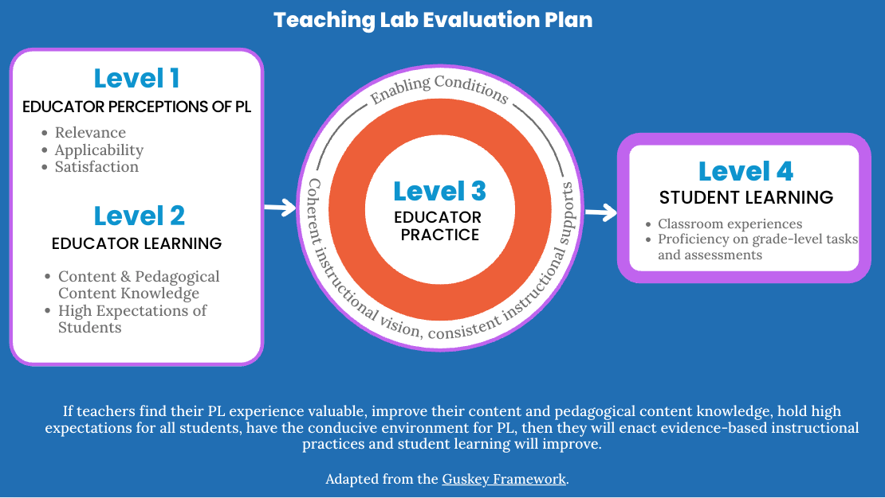
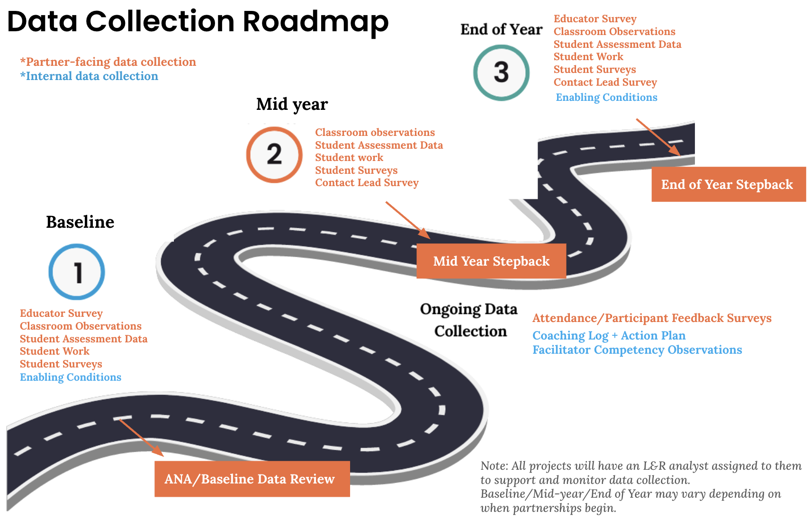
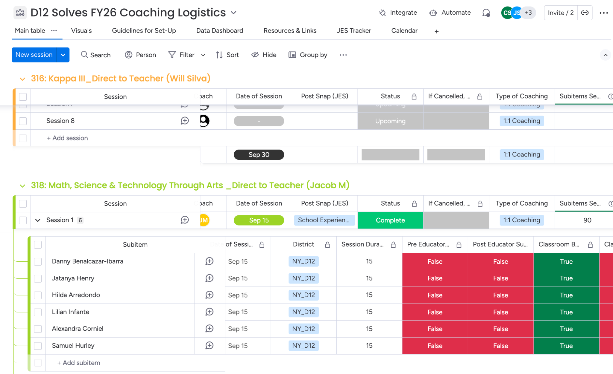

<!-- Generated by scripts/sync_google_docs.py from https://docs.google.com/document/d/1yvo1cW5i3OXtzN3Lf1lCRgw06Efbt0CH7n6PM53kELI/edit. Edit the Google Doc, not this file. -->

```{=html}
<p style="text-align:center"><span style="color:#00acf0"><strong>FY27 Teaching Lab Data Collection Overview Guide</strong></span></p><p><strong>This document serves as your one-stop resource for all project team data needs, providing high-level overviews with links to detailed resources</strong>. For questions, contact your assigned L&amp;R Analyst or the L&amp;R Team at (<a href="mailto:research@teachinglab.org">research@teachinglab.org</a>). Also review your <a href="https://drive.google.com/drive/folders/1TqAuIL_cMHavNSCQ4KSp3rZfMPEAsFKI?usp=drive_link" target="_blank" rel="noopener">project-specific data plan</a> for project-specific nuances in data collection expectations.</p><p><span style="color:#ff7b43"></span></p>
```

## What You’ll Find in This Guide {#what-you-ll-find-in-this-guide}

```{=html}
<div class="doc-cards"><div class="doc-card"><div class="doc-card-q">❓Want a refresher on what we collect and why it matters?</div><div class="doc-card-a">Start with the <a class="stretched-link" href="#teaching-lab-evaluation-plan">Teaching Lab Evaluation Plan</a> for the big picture of what we collect and why.</div></div><div class="doc-card"><div class="doc-card-q">🔍 Not sure what data is expected based on your scope?</div><div class="doc-card-a">Check out the overview of <a class="stretched-link" href="#data-collection-expectations-by-scope-of-work">Data Collection Expectations by Scope of Work</a> for guidelines.</div></div><div class="doc-card"><div class="doc-card-q">📎 Need survey or instrument links?</div><div class="doc-card-a">Jump to the <a class="stretched-link" href="#quick-links-guide">Quick Links Guide</a> for direct access to surveys and instrument links.</div></div><div class="doc-card"><div class="doc-card-q">📈Tracking your project’s data collection progress and key metrics?</div><div class="doc-card-a">Visit the <a class="stretched-link" href="#tracking-data-collection-progress-key-outcome-metrics">Tracking Data Collection Progress &amp; Key Outcome Metrics</a> page.</div></div><div class="doc-card"><div class="doc-card-q">📊 Wondering what Assets &amp; Needs Assessment (ANAs) are all about?</div><div class="doc-card-a">Review the<a class="stretched-link" href="#assets-needs-assessments-ana-data-collection-guide"> ANA Guide </a>for what they are and how they support your project.</div></div><div class="doc-card"><div class="doc-card-q">🎓Want to know more about what student data we collect?</div><div class="doc-card-a">See the quick overview of the different data collected in the <a class="stretched-link" href="#student-data-collection">Student Data Collection Guide</a>.</div></div><div class="doc-card"><div class="doc-card-q">🧠 Planning your Stepback?</div><div class="doc-card-a">Go to the <a class="stretched-link" href="#data-review-and-stepback-resources">Stepback </a>section to access tools and template decks.</div></div><div class="doc-card"><div class="doc-card-q">📈 Looking at results and not sure what they mean?</div><div class="doc-card-a">See the <a class="stretched-link" href="#analyzing-sharing-data">Analyzing &amp; Sharing Data Guide</a> for guidance on understanding and using results.</div></div><div class="doc-card"><div class="doc-card-q">❓Got additional questions?</div><div class="doc-card-a">Please visit our <a class="stretched-link" href="#faq">FAQ page</a> for additional questions related to data collection, access, and tracking</div></div></div>
```

## Teaching Lab Evaluation Plan {#teaching-lab-evaluation-plan}

```{=html}
<p>Teaching Lab’s evaluation plan is grounded in the <a href="https://tguskey.com/wp-content/uploads/Professional-Learning-1-Gauge-Impact-with-Five-Levels-of-Data.pdf" target="_blank" rel="noopener">Guskey Framework</a>, a widely recognized approach for evaluating professional learning. Our <a href="https://docs.google.com/document/d/19yDyFCx1KeSPHlD9SLvLfG76FRGdfChL1hnCo_dV1zQ/edit?tab=t.0" target="_blank" rel="noopener">evaluation plan</a> and the visuals below, taken from <a href="https://docs.google.com/presentation/d/1Vo844M0_Au8bqfeK5-hPdFh30oGRjzjCxwm6vctemQ8/edit?slide=id.g2ef8e83467e_0_752#slide=id.g2ef8e83467e_0_752" target="_blank" rel="noopener">this deck</a>, explain how we have adapted Guskey’s framework to our work.</p><p style="text-align:center"></p><p>Below is a general data collection roadmap for projects that run for the full school year. For projects that start later or follow a different timeline, “mid-year” and “end-of-year” may be interpreted as mid- and end-of-partnership to reflect the actual project schedule.</p><p style="text-align:center"></p>
```

## Data Collection Expectations by Scope of Work {#data-collection-expectations-by-scope-of-work}

```{=html}
<p>General data collection guidance by scope of work is provided below. Refer to your individual data collection plan in your project’s Monday.com workspace for project-specific plans and nuances. </p><div class="table-responsive"><table class="doc-table"><tr><td style="width:14.9%;vertical-align:top"></td><td colspan="2" class="doc-filled" style="width:33.1%;background-color:#00acf0;vertical-align:top"><p style="text-align:center"><strong>Teacher Coaching</strong></p></td><td colspan="2" class="doc-filled" style="width:34.2%;background-color:#d17df7;vertical-align:top"><p style="text-align:center"><strong>Teacher PL</strong></p></td><td class="doc-filled" style="width:17.8%;background-color:#ff7b43;vertical-align:top"><p style="text-align:center"><strong>School Leaders</strong></p></td></tr><tr><td class="doc-filled" style="width:14.9%;background-color:#43c6b9;vertical-align:middle"><p style="text-align:center"><strong>Service</strong></p></td><td class="doc-filled" style="width:16.7%;background-color:#00acf0;vertical-align:middle"><p style="text-align:center"><strong>High Dosage 1:1 Coaching</strong>, group coaching/PLCs</p></td><td class="doc-filled" style="width:16.4%;background-color:#00acf0;vertical-align:middle"><p style="text-align:center"><strong>Low Dosage 1:1 Coaching</strong>, group coaching/PLCs*</p></td><td class="doc-filled" style="width:15.9%;background-color:#d17df7;vertical-align:middle"><p style="text-align:center"><strong>High/Moderate Dosage </strong></p></td><td class="doc-filled" style="width:18.3%;background-color:#d17df7;vertical-align:middle"><p style="text-align:center"><strong>Low Dosage*</strong></p></td><td class="doc-filled" style="width:17.8%;background-color:#ff7b43;vertical-align:middle"><p style="text-align:center"><strong>School Leader Support</strong></p></td></tr><tr><td class="doc-filled" style="width:14.9%;background-color:#43c6b9;vertical-align:middle"><p style="text-align:center"><strong>Frequency</strong></p></td><td class="doc-filled" style="width:16.7%;background-color:#8fdcfa;vertical-align:middle"><p style="text-align:center">Weekly, biweekly, monthly with the same Ts</p></td><td class="doc-filled" style="width:16.4%;background-color:#8fdcfa;vertical-align:middle"><p style="text-align:center">Less than monthly with same Ts</p></td><td class="doc-filled" style="width:15.9%;background-color:#ebc5fc;vertical-align:middle"><p style="text-align:center"> ≥4 sessions</p></td><td class="doc-filled" style="width:18.3%;background-color:#ebc5fc;vertical-align:middle"><p style="text-align:center">Light scopes such as 1-day PL or PL with different Ts</p></td><td class="doc-filled" style="width:17.8%;background-color:#fab79b;vertical-align:middle"><p style="text-align:center">Any</p></td></tr><tr><td class="doc-filled" style="width:14.9%;background-color:#43c6b9;vertical-align:middle"><p style="text-align:center"><strong>Attendance/</strong></p><p style="text-align:center"><strong>Participant Feedback</strong></p></td><td class="doc-filled" style="width:16.7%;background-color:#8fdcfa;vertical-align:middle"><p style="text-align:center">✅</p></td><td class="doc-filled" style="width:16.4%;background-color:#8fdcfa;vertical-align:middle"><p style="text-align:center">✅</p></td><td class="doc-filled" style="width:15.9%;background-color:#ebc5fc;vertical-align:middle"><p style="text-align:center">✅</p></td><td class="doc-filled" style="width:18.3%;background-color:#ebc5fc;vertical-align:middle"><p style="text-align:center">✅</p></td><td class="doc-filled" style="width:17.8%;background-color:#fab79b;vertical-align:middle"><p style="text-align:center">✅</p></td></tr><tr><td class="doc-filled" style="width:14.9%;background-color:#43c6b9;vertical-align:middle"><p style="text-align:center"><strong>Educator Survey</strong></p></td><td class="doc-filled" style="width:16.7%;background-color:#8fdcfa;vertical-align:middle"><p style="text-align:center">✅</p></td><td class="doc-filled" style="width:16.4%;background-color:#8fdcfa;vertical-align:middle"><p style="text-align:center">✅</p></td><td class="doc-filled" style="width:15.9%;background-color:#ebc5fc;vertical-align:middle"><p style="text-align:center">✅</p></td><td class="doc-filled" style="width:18.3%;background-color:#ebc5fc;vertical-align:middle"><p style="text-align:center">Not required</p></td><td class="doc-filled" style="width:17.8%;background-color:#fab79b;vertical-align:middle"><p style="text-align:center">✅</p></td></tr><tr><td class="doc-filled" style="width:14.9%;background-color:#43c6b9;vertical-align:middle"><p style="text-align:center"><strong>Observations/</strong></p><p style="text-align:center"><strong>Walkthroughs</strong></p></td><td class="doc-filled" style="width:16.7%;background-color:#8fdcfa;vertical-align:middle"><p style="text-align:center">✅</p></td><td class="doc-filled" style="width:16.4%;background-color:#8fdcfa;vertical-align:middle"><p style="text-align:center">Recommended for a sample of Ts</p></td><td class="doc-filled" style="width:15.9%;background-color:#ebc5fc;vertical-align:middle"><p style="text-align:center">Recommended for a sample of Ts</p></td><td class="doc-filled" style="width:18.3%;background-color:#ebc5fc;vertical-align:middle"><p style="text-align:center">Not required</p></td><td class="doc-filled" style="width:17.8%;background-color:#fab79b;vertical-align:middle"><p style="text-align:center">✅</p></td></tr><tr><td class="doc-filled" style="width:14.9%;background-color:#43c6b9;vertical-align:middle"><p style="text-align:center"><strong>Student Work</strong></p></td><td colspan="2" class="doc-filled" style="width:33.1%;background-color:#8fdcfa;vertical-align:middle"><p style="text-align:center">Collected and analyzed through coaching cycles in Nisa</p><p style="text-align:center">Project teams can choose to submit to to L&amp;R for centralized grading if needed</p></td><td class="doc-filled" style="width:15.9%;background-color:#ebc5fc;vertical-align:middle"><p style="text-align:center">Recommended to collect and submit to L&amp;R for centralized grading</p></td><td class="doc-filled" style="width:18.3%;background-color:#ebc5fc;vertical-align:middle"><p style="text-align:center">Not required</p></td><td class="doc-filled" style="width:17.8%;background-color:#fab79b;vertical-align:middle"><p style="text-align:center">Collected and analyzed through coaching cycles in Nisa</p></td></tr><tr><td class="doc-filled" style="width:14.9%;background-color:#43c6b9;vertical-align:middle"><p style="text-align:center"><strong>Ss Assessment Data</strong></p></td><td class="doc-filled" style="width:16.7%;background-color:#8fdcfa;vertical-align:middle"><p style="text-align:center">✅</p></td><td class="doc-filled" style="width:16.4%;background-color:#8fdcfa;vertical-align:middle"><p style="text-align:center">✅</p></td><td class="doc-filled" style="width:15.9%;background-color:#ebc5fc;vertical-align:middle"><p style="text-align:center">✅</p></td><td class="doc-filled" style="width:18.3%;background-color:#ebc5fc;vertical-align:middle"><p style="text-align:center">Not required</p></td><td class="doc-filled" style="width:17.8%;background-color:#fab79b;vertical-align:middle"><p style="text-align:center">✅</p></td></tr><tr><td class="doc-filled" style="width:14.9%;background-color:#43c6b9;vertical-align:middle"><p style="text-align:center"><strong>Student Survey</strong></p></td><td class="doc-filled" style="width:16.7%;background-color:#8fdcfa;vertical-align:middle"><p style="text-align:center">Recommended</p></td><td class="doc-filled" style="width:16.4%;background-color:#8fdcfa;vertical-align:middle"><p style="text-align:center">Recommended</p></td><td class="doc-filled" style="width:15.9%;background-color:#ebc5fc;vertical-align:middle"><p style="text-align:center">Recommended</p></td><td class="doc-filled" style="width:18.3%;background-color:#ebc5fc;vertical-align:middle"><p style="text-align:center">Not required</p></td><td class="doc-filled" style="width:17.8%;background-color:#fab79b;vertical-align:middle"><p style="text-align:center">Recommended</p></td></tr></table></div><p>✅ indicates expected data collection activity.              *To maximize impact, we should prioritize higher-leverage scopes.</p>
```

## Quick Links Guide {#quick-links-guide}

```{=html}
<div class="table-responsive"><table class="doc-table"><tr><td colspan="6" class="doc-filled" style="width:100.0%;background-color:#fce5cd;vertical-align:middle"><p style="text-align:center"><strong>DATA COLLECTION LINKS &amp; RESOURCES</strong></p></td></tr><tr><td style="width:23.1%;vertical-align:middle"><p style="text-align:center"><span style="color:#ff7b43"><strong>WHAT</strong></span></p></td><td style="width:8.7%;vertical-align:middle"><p style="text-align:center"><span style="color:#ff7b43"><strong>WHEN</strong></span></p></td><td style="width:11.8%;vertical-align:middle"><p style="text-align:center"><span style="color:#ff7b43"><strong>WHO</strong></span></p></td><td colspan="2" style="width:41.0%;vertical-align:middle"><p style="text-align:center"><span style="color:#ff7b43"><strong>LINKS</strong></span></p></td><td style="width:15.4%;vertical-align:middle"><p style="text-align:center"><span style="color:#ff7b43"><strong>RESULTS</strong></span></p></td></tr><tr><td style="width:23.1%;vertical-align:middle"><p style="text-align:center"><strong>Professional Learning/Coaching Participant Roster</strong></p></td><td style="width:8.7%;vertical-align:middle"><p style="text-align:center">BOY</p></td><td style="width:11.8%;vertical-align:middle"><p style="text-align:center">CPM/</p><p style="text-align:center">Coach</p></td><td colspan="2" style="width:41.0%;vertical-align:middle"><p><a href="https://docs.google.com/document/d/1nmPOmJ4Snz-mQgrZ8eCA33a0CfiWjQmpcuA25YE3Qgo/edit?tab=t.0#heading=h.vh848yo1eveh" target="_blank" rel="noopener">SY26-27 Participant Rostering Process</a></p></td><td style="width:15.4%;vertical-align:middle"><p style="text-align:center"><a href="https://teachinglab.monday.com/boards/18416567790/views/262401286" target="_blank" rel="noopener">Participant Roster Monday Board</a></p></td></tr><tr><td style="width:23.1%;vertical-align:middle"><p style="text-align:center"><strong>Attendance/</strong></p><p style="text-align:center"><strong>Participant Feedback</strong></p></td><td style="width:8.7%;vertical-align:middle"><p style="text-align:center">Ongoing</p></td><td style="width:11.8%;vertical-align:middle"><p style="text-align:center">Participant</p></td><td style="width:33.7%;vertical-align:top"><p><strong>Participant Link: </strong><a href="http://tinyurl.com/TL-feedback" target="_blank" rel="noopener">http://tinyurl.com/TL-feedback</a></p><p><strong>Internal Review/Testing:  </strong><a href="https://surveys.teachinglab.org/jfe5/preview/previewId/d8262bde-e08e-4b62-bfec-5eb53eef4845/SV_cBaoLkjhoXkOG4S?Q_CHL=preview&amp;Q_SurveyVersionID=current" target="_blank" rel="noopener">Qualtrics</a></p><p><strong>External Sharing of Content:</strong> <a href="https://docs.google.com/document/d/1hcpZOk-6IODD3ApZxWhd7_6hlsA2tVuHYWDNnGVw1RQ/edit" target="_blank" rel="noopener">Google Doc</a></p></td><td style="width:7.4%;vertical-align:middle"><p style="text-align:center"></p></td><td style="width:15.4%;vertical-align:middle"><p style="text-align:center"><a href="/Dashboards.html#participant-perceptions">Feedback Dashboards</a><br></p><p style="text-align:center"><a href="https://tl-data.teachinglab.org/ongoing_report/" target="_blank" rel="noopener">Ongoing Report</a></p></td></tr><tr><td style="width:23.1%;vertical-align:middle"><p style="text-align:center"><strong>Educator Survey</strong></p></td><td style="width:8.7%;vertical-align:middle"><p style="text-align:center">BOY</p><p style="text-align:center">EOY</p></td><td style="width:11.8%;vertical-align:middle"><p style="text-align:center">Participant</p></td><td style="width:33.7%;vertical-align:top"><p><strong>Participant Link: </strong><a href="https://tinyurl.com/TLEducatorSurvey" target="_blank" rel="noopener">https://tinyurl.com/TLEducatorSurvey</a> </p><p><strong>Internal Review/Testing:</strong> <a href="https://surveys.teachinglab.org/jfe5/preview/previewId/b5f6d7ca-2ac2-418c-a627-5f5fb01c7e73/SV_ahD6iIpcybD1u2G?Q_CHL=preview&amp;Q_SurveyVersionID=current" target="_blank" rel="noopener">Qualtrics</a></p><p><strong>External Sharing of Content:</strong> <a href="https://docs.google.com/document/d/1hcldd1oL5Y0SA3kUl1cCYeZmDIDv_KCbcT7Z4Z0tfUQ/edit#heading=h.yzd8v9vdhwxw" target="_blank" rel="noopener">Google Doc</a></p></td><td style="width:7.4%;vertical-align:middle"><p style="text-align:center"></p></td><td style="width:15.4%;vertical-align:middle"><p style="text-align:center"><a href="/Dashboards.html#participant-mindsets">Mindset Dashboards<br> </a></p><p style="text-align:center"><a href="https://tl-data.teachinglab.org/ongoing_report/" target="_blank" rel="noopener">Ongoing Report</a></p></td></tr><tr><td style="width:23.1%;vertical-align:middle"><p style="text-align:center"><strong>Classroom Observations</strong></p></td><td style="width:8.7%;vertical-align:middle"><p style="text-align:center">BOY</p><p style="text-align:center">MOY</p><p style="text-align:center">EOY</p></td><td style="width:11.8%;vertical-align:middle"><p style="text-align:center">Coach</p></td><td colspan="2" style="width:41.0%;vertical-align:middle"><p><strong>Link: </strong><a href="https://tinyurl.com/TLobservations" target="_blank" rel="noopener">https://tinyurl.com/TLobservations</a> </p><p><strong>Internal Review/Testing:</strong> <a href="https://surveys.teachinglab.org/jfe7/preview/previewId/c3a5f45f-814d-48bc-8d28-31601b059729/SV_0DGUXmHmlnTOZim?Q_CHL=preview&amp;Q_SurveyVersionID=current" target="_blank" rel="noopener">Qualtrics</a></p><p>External Sharing of Content: <a href="https://docs.google.com/document/d/1CRmA4O3Ha042gHq-6EPLPr3BJ7OKlSrglZybDTXhVJ0/edit?tab=t.0#heading=h.yzd8v9vdhwxw" target="_blank" rel="noopener">Google Doc</a></p></td><td style="width:15.4%;vertical-align:middle"><p style="text-align:center"><a href="/Dashboards.html#participant-practices">Observation Dashboards </a><br></p><p style="text-align:center"><a href="https://tl-data.teachinglab.org/ongoing_report/" target="_blank" rel="noopener">Ongoing Report</a></p></td></tr><tr><td style="width:23.1%;vertical-align:middle"><p style="text-align:center"><strong>Student Assessment Data</strong></p></td><td style="width:8.7%;vertical-align:middle"><p style="text-align:center">BOY</p><p style="text-align:center">MOY</p><p style="text-align:center">EOY</p></td><td style="width:11.8%;vertical-align:middle"><p style="text-align:center">PL/CPM</p></td><td colspan="2" style="width:41.0%;vertical-align:top"><p><a href="https://docs.google.com/document/d/1V0MmW7_AtCsaFxrvBriWS9f1BCWI9sbpMZf0viJtj7c/edit" target="_blank" rel="noopener">Student Assessment Data Guidelines</a></p></td><td style="width:15.4%;vertical-align:middle"><p style="text-align:center">TBD</p></td></tr><tr><td style="width:23.1%;vertical-align:middle"><p style="text-align:center"><strong>Student Work</strong></p></td><td style="width:8.7%;vertical-align:middle"><p style="text-align:center">BOY</p><p style="text-align:center">MOY</p><p style="text-align:center">EOY</p></td><td style="width:11.8%;vertical-align:middle"><p style="text-align:center">Coach/ Participant</p></td><td colspan="2" style="width:41.0%;vertical-align:middle"><p><strong>Link: </strong><a href="https://tinyurl.com/TLstudentwork" target="_blank" rel="noopener">https://tinyurl.com/TLstudentwork</a></p><p><strong>Internal Review/Testing:</strong> <a href="https://surveys.teachinglab.org/jfe/preview/previewId/852b807b-32b9-4865-99d6-f58771518787/SV_0H7xUSb8qixVCDk?Q_CHL=preview&amp;Q_SurveyVersionID=current" target="_blank" rel="noopener">Qualtrics</a></p></td><td style="width:15.4%;vertical-align:middle"><p style="text-align:center"><a href="/Dashboards.html#student-learning-experiences">Student Experiences Dashboards</a><br></p><p style="text-align:center"> <a href="https://tl-data.teachinglab.org/ongoing_report/" target="_blank" rel="noopener">Ongoing Report</a></p></td></tr><tr><td style="width:23.1%;vertical-align:middle"><p style="text-align:center"><strong>Student Survey</strong></p></td><td style="width:8.7%;vertical-align:middle"><p style="text-align:center">BOY</p><p style="text-align:center">EOY</p></td><td style="width:11.8%;vertical-align:middle"><p style="text-align:center">Students of Participant</p></td><td style="width:33.7%;vertical-align:middle"><p style="text-align:center">L&amp;R Team will send participants individualized survey links using the participant list from project teams.</p><p>Internal Review/Testing: <a href="https://surveys.teachinglab.org/survey-builder/SV_cDg05ZZPWuH94km/edit" target="_blank" rel="noopener">Qualtrics</a></p><p>External Sharing of Content: <a href="https://docs.google.com/document/d/1BtrBPIWNtsEeJa4KTLiUHZba54tLnn_4NZe5DBPmHp0/edit" target="_blank" rel="noopener">Google Doc</a></p><p><a href="https://docs.google.com/document/d/1V0MmW7_AtCsaFxrvBriWS9f1BCWI9sbpMZf0viJtj7c/edit" target="_blank" rel="noopener">Student Data Guidelines</a></p></td><td style="width:7.4%;vertical-align:middle"><p></p></td><td style="width:15.4%;vertical-align:middle"><p style="text-align:center"><a href="/Dashboards.html#student-learning-experiences">Student Experiences Dashboards</a><br></p><p style="text-align:center"><a href="https://tl-data.teachinglab.org/ongoing_report/" target="_blank" rel="noopener">Ongoing Report</a></p></td></tr><tr><td style="width:23.1%;vertical-align:middle"><p style="text-align:center"><strong>Contact Lead Survey</strong></p></td><td style="width:8.7%;vertical-align:middle"><p style="text-align:center">MOY</p><p style="text-align:center">EOY</p></td><td style="width:11.8%;vertical-align:middle"><p style="text-align:center">Main Partner Contacts</p></td><td style="width:33.7%;vertical-align:top"><p><strong>Link: </strong><a href="https://tinyurl.com/TLContactLead" target="_blank" rel="noopener">https://tinyurl.com/TLContactLead</a> </p><p><strong>Internal Review/Testing:</strong> <a href="https://surveys.teachinglab.org/jfe/preview/previewId/772113d7-c003-45a4-9ff7-968a9cc31504/SV_6s9l6Uk1BSTvSqa?Q_CHL=preview&amp;Q_SurveyVersionID=current" target="_blank" rel="noopener">Qualtrics</a></p><p>External Sharing of Content: <a href="https://docs.google.com/document/d/1VocCsPo2BwkjKexNYND7j5K58OC57FdUH-lv_z1UZp4/edit?tab=t.0" target="_blank" rel="noopener">Google Doc</a></p></td><td style="width:7.4%;vertical-align:middle"><p style="text-align:center"></p></td><td style="width:15.4%;vertical-align:middle"><p style="text-align:center"><a href="https://tl-data.teachinglab.org/ongoing_report/" target="_blank" rel="noopener">Ongoing Report</a></p></td></tr><tr><td style="width:23.1%;vertical-align:middle"><p style="text-align:center"><strong>Enabling Conditions Rubric</strong></p></td><td style="width:8.7%;vertical-align:middle"><p style="text-align:center">BOY </p><p style="text-align:center">EOY</p></td><td style="width:11.8%;vertical-align:middle"><p style="text-align:center">PL/CPM</p></td><td style="width:33.7%;vertical-align:top"><p><strong>Link: </strong><a href="https://tinyurl.com/TLenabling" target="_blank" rel="noopener">https://tinyurl.com/TLenabling</a></p><p><strong>Internal Review/Testing:</strong> <a href="https://surveys.teachinglab.org/jfe7/preview/previewId/5bc9e6bc-507f-4256-be30-2fd86944fcbf/SV_dmYrUgpvaAE4zKm?Q_CHL=preview&amp;Q_SurveyVersionID=current" target="_blank" rel="noopener">Qualtrics</a></p><p><strong>External Sharing of Content: </strong><a href="https://docs.google.com/document/d/10Fq_bx3KaeIZxN-0KdTTHFMx7WhwMFzg8zWgEiETB4o/edit?usp=sharing" target="_blank" rel="noopener">Google Doc</a></p></td><td style="width:7.4%;vertical-align:middle"><p style="text-align:center"></p></td><td style="width:15.4%;vertical-align:middle"><p style="text-align:center"><a href="https://tl-data.teachinglab.org/ongoing_report/" target="_blank" rel="noopener">Ongoing Report Enabling Conditions Section</a> </p></td></tr></table></div><div class="table-responsive"><table class="doc-table"><tr><td colspan="6" class="doc-filled" style="width:100.0%;background-color:#fce5cd;vertical-align:middle"><p style="text-align:center"><strong>OTHER INTERNAL IMPLEMENTATION LINKS &amp; RESOURCES</strong></p></td></tr><tr><td style="width:23.9%;vertical-align:middle"><p style="text-align:center"><span style="color:#ff7b43"><strong>WHAT</strong></span></p></td><td style="width:8.9%;vertical-align:middle"><p style="text-align:center"><span style="color:#ff7b43"><strong>WHEN</strong></span></p></td><td style="width:11.1%;vertical-align:middle"><p style="text-align:center"><span style="color:#ff7b43"><strong>WHO</strong></span></p></td><td colspan="2" style="width:41.3%;vertical-align:middle"><p style="text-align:center"><span style="color:#ff7b43"><strong>LINKS</strong></span></p></td><td style="width:14.8%;vertical-align:middle"><p style="text-align:center"><span style="color:#ff7b43"><strong>RESULTS</strong></span></p></td></tr><tr><td style="width:23.9%;vertical-align:middle"><p style="text-align:center"><strong>Facilitation Competency Observation</strong></p></td><td style="width:8.9%;vertical-align:middle"><p style="text-align:center"><strong>Ongoing</strong></p></td><td style="width:11.1%;vertical-align:middle"><p>PL/CPM/ Coach Developer</p></td><td style="width:34.1%;vertical-align:top"><p>Link: <a href="https://tinyurl.com/FacilitationCompetency" target="_blank" rel="noopener">https://tinyurl.com/FacilitationCompetency</a> </p><p>Internal Review/Testing: <a href="https://surveys.teachinglab.org/survey-builder/SV_8ldVeywLkOMgugK/edit" target="_blank" rel="noopener">Qualtrics</a></p><p>External Sharing of Content: <a href="https://docs.google.com/document/d/1V5QiUk9zPUUhu3gqecMQCzYjmy6OpMlX9PzrhHu9kWI/edit?usp=sharing" target="_blank" rel="noopener">Google Doc</a></p></td><td style="width:7.2%;vertical-align:middle"><p style="text-align:center"></p></td><td style="width:14.8%;vertical-align:middle"><p style="text-align:center"><a href="/Dashboards.html#participant-perceptions">Participant Perception Dashboards </a>on the Data Hub</p></td></tr><tr><td style="width:23.9%;vertical-align:middle"><p style="text-align:center"><strong>Coaching Log</strong></p></td><td style="width:8.9%;vertical-align:middle"><p style="text-align:center"><strong>Ongoing</strong></p></td><td style="width:11.1%;vertical-align:middle"><p style="text-align:center">Coach</p></td><td colspan="2" style="width:41.3%;vertical-align:middle"><p><strong>Link: </strong><a href="https://tl-form-hub.vercel.app/coach-log-form" target="_blank" rel="noopener">Coaching Log Form</a></p></td><td style="width:14.8%;vertical-align:middle"><p style="text-align:center"><a href="https://teachinglab.monday.com/boards/18416482214/" target="_blank" rel="noopener">FY27 Coaching Log board</a></p></td></tr></table></div>
```

## Tracking Data Collection Progress & Key Outcome Metrics {#tracking-data-collection-progress-key-outcome-metrics}

```{=html}
<p>Please refer to the <strong><a href="https://docs.google.com/spreadsheets/d/16PLobzihuwtYfqCg0Uk1YivBcbLtOFfclualc72WVRU/edit?gid=0#gid=0" target="_blank" rel="noopener">FY27 Data Collection Tracker</a></strong><span style="color:#ff0000"> </span>to monitor data collection completion rates.<strong> The tracker includes:</strong></p><ul><li><strong>Overall completion rates</strong> for all projects in the <strong>Project Overview</strong> tab.</li><li><strong>Individual project tabs,</strong> each showing a <strong>participant-level breakdown</strong> of which participants have completed which data collection activities.</li></ul><p><strong>Filtering the Data Collection Tracker</strong></p><p>To protect the integrity of the tracker, general users have <em>comment-only access</em>. This means you cannot apply a traditional filter directly to the sheet, since doing so would change the view for everyone else. Instead, you’ll need to use a filter view, which lets you filter and sort data without affecting what other users see.</p><p><strong>How to create a filter view:</strong></p><ol><li>Click the <strong>Data</strong> tab at the top of the sheet.</li><li>From the dropdown, select <strong>Create filter view</strong>.</li><li>Use the header row to set up your filter criteria.</li></ol><p>By using a filter view rather than a standard filter, you can look at the exact data you need while ensuring that the tracker remains stable and accessible for all users.</p><p><strong>Where to Access the Tracker</strong></p><p>Please visit the <strong><a href="https://sites.google.com/teachinglab.org/staffsite/learning-research/data-collection" target="_blank" rel="noopener">L&amp;R section of the TL Team Hub</a></strong> to access the <strong><a href="https://docs.google.com/spreadsheets/d/1V3yu5vfrbeRWyMn0nY6POHZHehBpO28QayY2hn6pAe4/edit?gid=417843156#gid=417843156" target="_blank" rel="noopener">FY26 Data Collection Tracker</a>.</strong></p>
```

## Assets & Needs Assessments (ANA) Data Collection Guide {#assets-needs-assessments-ana-data-collection-guide}

```{=html}
<p>Teaching Lab’s <a href="https://docs.google.com/document/d/1fAcY29mzR2ergk8MSk2khctw695NA6p0TOcwC6v-UuM/edit?tab=t.0" target="_blank" rel="noopener">Assets &amp; Needs Assessment (ANA)</a> is the first step in identifying the most strategic focus areas for our work with a new partner, enabling tailored service design, building partner confidence in our data-driven approach, and equipping project teams with essential context before implementation begins.</p><p>❗<strong>Important: </strong></p><p><strong>🏫 Which partners engage in the ANA data collection activities?</strong> All new partners complete the qualitative ANA activities listed below, along with any baseline data collection relevant to their scope of work (e.g., Educator Survey, walkthroughs/observations, student work, student assessment data review). For returning partners, we recommend conducting an ANA when new schools or participants are part of the project.</p><p><strong>📆 When does the ANA happen? </strong>Some first-year partners may contract the ANA as a stand-alone service before a full scope of work is developed (e.g., ANA in the spring, services beginning in the fall). For others, ANA activities take place alongside early baseline data collection at the start of the partnership.</p><div class="table-responsive"><table class="doc-table"><tr><td colspan="4" class="doc-filled" style="width:100.0%;background-color:#fce5cd;vertical-align:middle"><p style="text-align:center"><strong>ANA Data Collection</strong></p></td></tr><tr><td style="width:22.3%;vertical-align:middle"><p style="text-align:center"><span style="color:#ff7b43"><strong>WHAT</strong></span></p></td><td style="width:15.5%;vertical-align:middle"><p style="text-align:center"><span style="color:#ff7b43"><strong>WHO</strong></span></p></td><td style="width:33.8%;vertical-align:middle"><p style="text-align:center"><span style="color:#ff7b43"><strong>LINKS</strong></span></p></td><td style="width:28.4%;vertical-align:middle"><p style="text-align:center"><span style="color:#ff7b43"><strong>RESULTS</strong></span></p></td></tr><tr><td style="width:22.3%;vertical-align:middle"><p style="text-align:center"><span style="color:#ff7b43"><strong>ANA Leader Interviews</strong></span></p></td><td style="width:15.5%;vertical-align:middle"><p style="text-align:center">Project Leads/CPMs</p></td><td style="width:33.8%;vertical-align:top"><p><a href="https://docs.google.com/document/d/1kmdsXHFP8TY5bD2IXoZpNA2t56KbLKvN1Y5sodNoIKY/edit" target="_blank" rel="noopener">Interview Questions</a> - make a copy</p></td><td style="width:28.4%;vertical-align:middle"><p>Make a copy and save in partner folder</p></td></tr><tr><td style="width:22.3%;vertical-align:middle"><p style="text-align:center"><span style="color:#ff7b43"><strong>Teacher Interviews/Focus Groups*</strong></span></p></td><td style="width:15.5%;vertical-align:middle"><p style="text-align:center">Project Leads/CPMs</p></td><td style="width:33.8%;vertical-align:top"><p><a href="https://docs.google.com/document/d/1ygJ_JlMrCgA2V4KRLtEU0Dhk5heqdTGSVBBLYJbK1Dg/edit?usp=sharing" target="_blank" rel="noopener">Interview/Focus Group Questions</a> - make a copy </p></td><td style="width:28.4%;vertical-align:middle"><p>Make a copy and save in partner folder</p></td></tr><tr><td style="width:22.3%;vertical-align:middle"><p style="text-align:center"><span style="color:#ff7b43"><strong>Analysis of Artifacts</strong></span></p></td><td style="width:15.5%;vertical-align:middle"><p style="text-align:center">Project Leads/CPMs</p></td><td style="width:33.8%;vertical-align:top"><p><a href="https://docs.google.com/document/d/1fAcY29mzR2ergk8MSk2khctw695NA6p0TOcwC6v-UuM/edit?usp=sharing" target="_blank" rel="noopener">Standard versus Comprehensive ANA instructions</a> - artifacts are on page 9</p><p><a href="https://docs.google.com/document/d/1harC__XnXdYAfsSZYvcYim-fT3cQ2KtThpagt4boxJU/edit?usp=sharing" target="_blank" rel="noopener">Artifact analysis guide</a>– make a copy </p></td><td style="width:28.4%;vertical-align:middle"><p>Save copies of artifacts in partner folder</p></td></tr></table></div><p><em>*While it is not always possible to facilitate a teacher touchpoint with all partners, we strongly recommend doing so to more authentically capture the teacher perspective.</em></p>
```

## Student Data Collection {#student-data-collection}

```{=html}
<p>Teaching Lab collects three main types of student data to measure student outcomes: <strong>student assessment data, student work samples, and student surveys. </strong>Together, these sources help us identify growth areas, strengthen our approach, and assess impact.</p><p><strong>❗</strong><span style="color:#00acf0"> </span><span style="color:#00acf0"><strong>For the full student data collection guide, please reference</strong></span> <strong><a href="https://docs.google.com/document/d/1V0MmW7_AtCsaFxrvBriWS9f1BCWI9sbpMZf0viJtj7c/edit?usp=sharing" target="_blank" rel="noopener">this resource.</a></strong></p><p style="text-align:center"><strong>📊 Student Assessment Data</strong></p><p>Student assessment data is our top priority because it provides the most comparable measure of learning. We prioritize standardized screeners, benchmarks, and summative tests (e.g., Acadience, MAP, i-Ready, state tests); when these are unavailable, we rely on curriculum-embedded or formative assessments. Ideal datasets include Teaching Lab-supported and unsupported groups (classrooms, schools, districts) for comparison.</p><p style="text-align:center"><strong>✍️ Student Work Collection</strong></p><p>Student work samples provide insight into how learning develops across partnerships. <strong>Starting in FY27, for high-dosage coaching projects, student work will primarily be reported on in Nisa as part of the coaching cycle. </strong>Centralized student work collection and grading is still available as an option for projects that need it (for example, if project goals or KSIs include specific student outcome measures that require standardized grading or analysis.) Centralized grading should be planned with the L&amp;R Analyst during project design.<br><br>For student work submitted to L&amp;R for centralized grading, all work samples must be <strong>on-grade level; come from the HQIM or otherwise be standards-aligned; and represent a task that evidences student thinking. </strong><br></p><p style="text-align:center"><strong>📝 Student Surveys</strong></p><p>Student surveys capture firsthand perspectives of their learning and classroom experiences, complementing assessments and work samples. Administered twice a year in grades 3–12, they are anonymous, bilingual (English/Spanish), and take ~15-20 minutes. Surveys ask about the work students do and how they feel about learning. Results are aggregated to highlight patterns and inform improvement.</p>
```

## Data Review and Stepback Resources {#data-review-and-stepback-resources}

```{=html}
<p><strong>What are Data Reviews and Stepbacks? </strong>Stepbacks are formal meetings with each partner that happen periodically three times throughout the year (see below for exact timeline). The purpose of a Stepback is to revisit/realign on partnership goals, review data that demonstrates progress towards those goals, and to discuss future strategy based on the data.</p><p><strong>When do Data Reviews and/or Stepbacks occur? </strong>In a standard, year-long partnership, there are three stepbacks. One occurs at the beginning of the year (“baseline”), one in the middle of the year (“mid-year”), and one at the end of the year (“end-of-year”). If a partnership starts later into the year, such as midway through the year, they may only have two stepbacks (“baseline” when they begin and “end-of-year” at the end of the school year). </p><p><strong>What is the goal of each data meeting?</strong></p><ul><li><strong>ANA/Baseline Data Review: </strong>Informs service delivery and strategy</li><li><strong>Mid-Year Stepbacks: </strong>Informs pivots and refinements in services and strategy</li><li><strong>End-of-Year Stepbacks:</strong> Informs future planning and service offerings</li></ul><p><strong>How do I prepare for a Stepback?</strong></p><div class="table-responsive"><table class="doc-table"><tr><td colspan="5" class="doc-filled" style="width:100.0%;background-color:#ff7b43;vertical-align:top"><p style="text-align:center"><strong>Preparation Timeline and Process Overview</strong></p></td></tr><tr><td class="doc-filled" style="width:20.9%;background-color:#fce5cd;vertical-align:top"><p style="text-align:center"><strong>6 weeks before stepback</strong></p></td><td class="doc-filled" style="width:22.2%;background-color:#fce5cd;vertical-align:top"><p style="text-align:center"><strong>3-4 weeks before stepbacks</strong></p></td><td class="doc-filled" style="width:20.2%;background-color:#fce5cd;vertical-align:top"><p style="text-align:center"><strong>2-3 weeks before stepbacks</strong></p></td><td class="doc-filled" style="width:20.3%;background-color:#fce5cd;vertical-align:top"><p style="text-align:center"><strong>1-2 weeks before stepbacks</strong></p></td><td class="doc-filled" style="width:16.4%;background-color:#fce5cd;vertical-align:top"><p style="text-align:center"><strong>By Stepbac<em>k</em></strong></p></td></tr><tr><td style="width:20.9%;vertical-align:top"><p>CPM/PL enters (estimated) stepback date in team logistics boards in Monday.com.<br></p><p>Allow <strong>2–3 weeks for L&amp;R prep</strong> of the stepback deck.</p></td><td style="width:22.2%;vertical-align:top"><p>CPM/PL completes planning tool to align data story with partnership goals.</p><p>For MOY/EOY: CPM/PL send <a href="https://teachinglab.iad1.qualtrics.com/jfe/form/SV_cTJGFaslXUpKVgi" target="_blank" rel="noopener">Contact Lead Survey</a> to partner leads</p></td><td rowspan="2" style="width:20.2%;vertical-align:top"><p>L&amp;R completes data section of deck.</p><p>Program team completes intro + closing sections.</p></td><td rowspan="2" style="width:20.3%;vertical-align:top"><p>L&amp;R + Program team revise deck together to craft the partner data story (strengths + growth areas).</p></td><td rowspan="2" style="width:16.4%;vertical-align:top"><p>For BOY/EOY: Project team completes enabling conditions rubric for partner.</p></td></tr><tr><td colspan="2" style="width:100.0%;vertical-align:top"><p>Work to collect missing/additional data <strong>—---------------------------------------------&gt;&gt;</strong></p></td></tr></table></div><p><strong>Important Links: </strong></p><ul><li><strong><a href="https://drive.google.com/drive/folders/1FWfcBOTHcGBlOXAHEyouDt72_cW4CPWS?usp=sharing" target="_blank" rel="noopener">Planning Templates</a></strong></li><li><strong><a href="https://drive.google.com/drive/folders/17IFgbeDxlO9ziU2CPFnSJK28C295cb8v?usp=sharing" target="_blank" rel="noopener">Baseline/ANA Data Review Decks</a></strong></li><li><strong><a href="https://drive.google.com/drive/folders/1YZxzYCJrpXlqlHnogLnp9xHr2uAoCPOV?usp=sharing" target="_blank" rel="noopener">Mid-Year Stepback Decks</a></strong></li><li><strong><a href="https://drive.google.com/drive/folders/1Jxf9EUtu6mhcAaYuKXzWRumxo8QMz1Og?usp=sharing" target="_blank" rel="noopener">End-of-Year Stepback Decks</a></strong></li></ul>
```

## Analyzing & Sharing Data {#analyzing-sharing-data}

```{=html}
<div class="table-responsive"><table class="doc-table"><tr><td class="doc-filled" style="width:100.0%;background-color:#00acf0;vertical-align:top"><p style="text-align:center"><strong>Analyzing and Sharing Data</strong></p></td></tr><tr><td style="width:100.0%;vertical-align:top"><p style="text-align:center">As a learning organization, we are all committed to collecting and utilizing high quality data to inform our practice. While the L&amp;R team is responsible for providing access to data results and initial analyses, program teams are responsible for integrating these results into their practice, ideally analyzing and sharing data consistently throughout the year to inform their work with facilitators and partners.</p><p style="text-align:center">The L&amp;R team created a guide that offers instructions on how we recommend integrating data into your practice. We provide steps, tips, and resources on how to meaningfully analyze and share each key piece of data that is available to you.  <span style="color:#ffffff"><strong><a href="https://docs.google.com/document/d/1wDnA5D_EAV6dJWdJY9LqZnUnnHJMB_jVgYWAwWaFOzo/edit" target="_blank" rel="noopener">You can access the Analyzing and Sharing Data Guide guide here</a></strong></span><span style="color:#ffffff"><strong>.</strong></span> On the first page is a link to each piece of data that we collect and that is available for analysis and sharing. If you have any questions or would like support, don’t hesitate to reach out to an L&amp;R team member for support! We are here to ensure data is easily accessible and useful to you.</p></td></tr></table></div>
```

## FAQ {#faq}

```{=html}
<p><strong>Beginning of Year Data Collection and Tracking FAQs</strong></p><ul><li><strong>(Coaches) What do I do if my teacher/admin names are not showing up in the coaching log</strong>?<ul><li>Check if they are rostered: <span style="color:#1c4251"> </span><a href="https://teachinglab.monday.com/boards/18416567790/views/262401286" target="_blank" rel="noopener">SY26-27 Participant Roster Monday Board</a></li><li>If they’re not, work with your CPM to get them rostered via<span style="color:#1c4251"> </span><span style="color:#0a7faa"><a href="https://tl-coach-log-form-1a0068b965da.herokuapp.com/participant-roster-form" target="_blank" rel="noopener">Single Entry Form</a></span><span style="color:#0a7faa"> </span><span style="color:#1c4251">or </span><span style="color:#0a7faa"><a href="https://docs.google.com/document/d/1nmPOmJ4Snz-mQgrZ8eCA33a0CfiWjQmpcuA25YE3Qgo/edit?tab=t.0#bookmark=id.9tlqm4mj2x7d" target="_blank" rel="noopener">bulk upload</a></span><span style="color:#0a7faa">.</span></li></ul></li><li><strong>(Coaches) What do I do if my teacher/admin names are not showing up in the </strong><span style="color:#0a7faa"><strong><a href="https://tinyurl.com/TLobservations" target="_blank" rel="noopener">Classroom Observation Form</a></strong></span><span style="color:#1c4251"><strong>? </strong></span><ul><li>If they’re not rostered, see instructions above. </li><li>If they’ve been rostered for at least 24 hrs, they should be listed in the IPG. If you don’t see their names, it’s likely because Qualtrics saves your browser history &amp; remembers where you left off. Try these workarounds:<ul><li>Select “Other” and type in the teacher name</li><li>Complete the survey in Incognito Mode</li><li>Open a new survey in a different browser</li></ul></li></ul></li><li><strong>(Project Teams) How do I track BOY data completion? </strong><ul><li>The<span style="color:#0a7faa"> </span><span style="color:#0a7faa"><a href="https://docs.google.com/spreadsheets/d/1V3yu5vfrbeRWyMn0nY6POHZHehBpO28QayY2hn6pAe4/edit?gid=1451128298#gid=1451128298" target="_blank" rel="noopener">Coaching Data Collection Tracker</a></span> is live! So you can  track data collection by coachee in this spreadsheet (assuming they're rostered)</li><li>We have data collection tracking columns in the <strong>Coaching Logistics boards</strong> as well - they should auto-update after coaching logs are submitted (assuming the dates match the logistics boards).<ul><li>This reflects what participants have completed up to the date the log is submitted (e.g., a log submitted on 9/23 shows data completion through 9/23).</li></ul></li></ul></li></ul><p></p>
```
